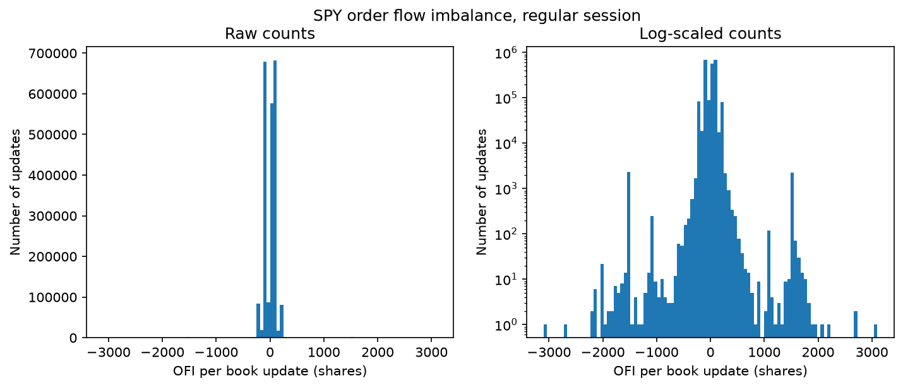
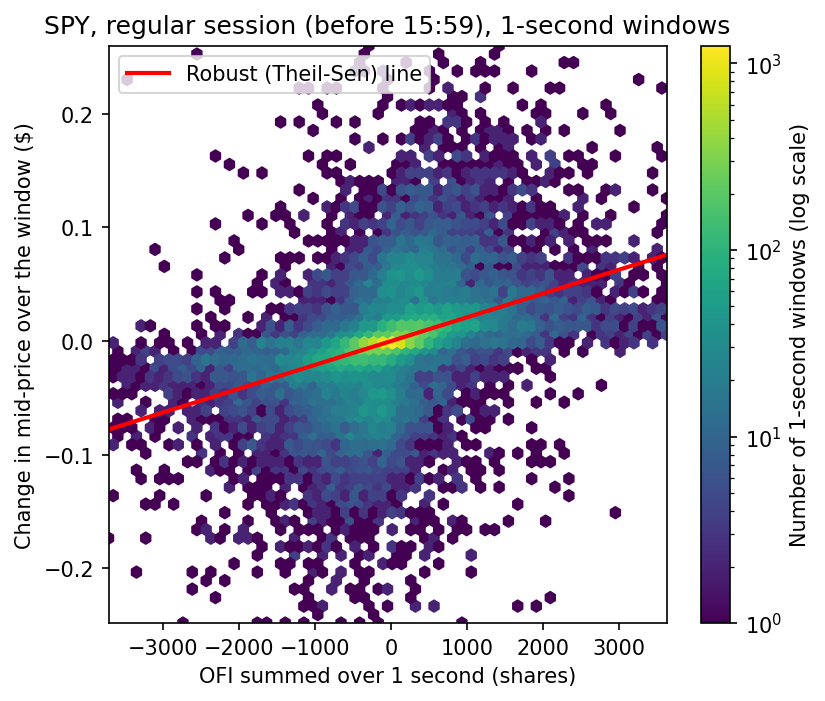
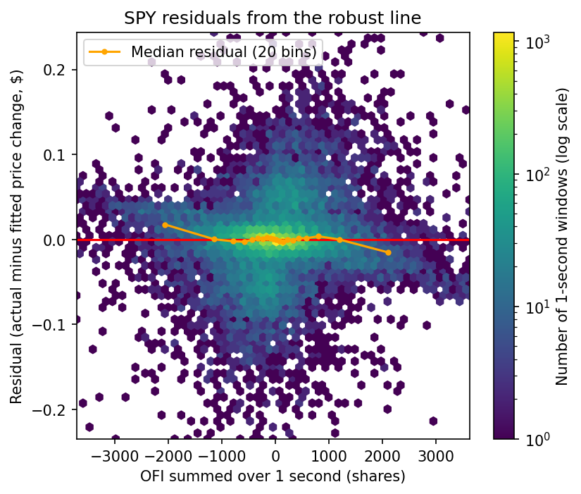
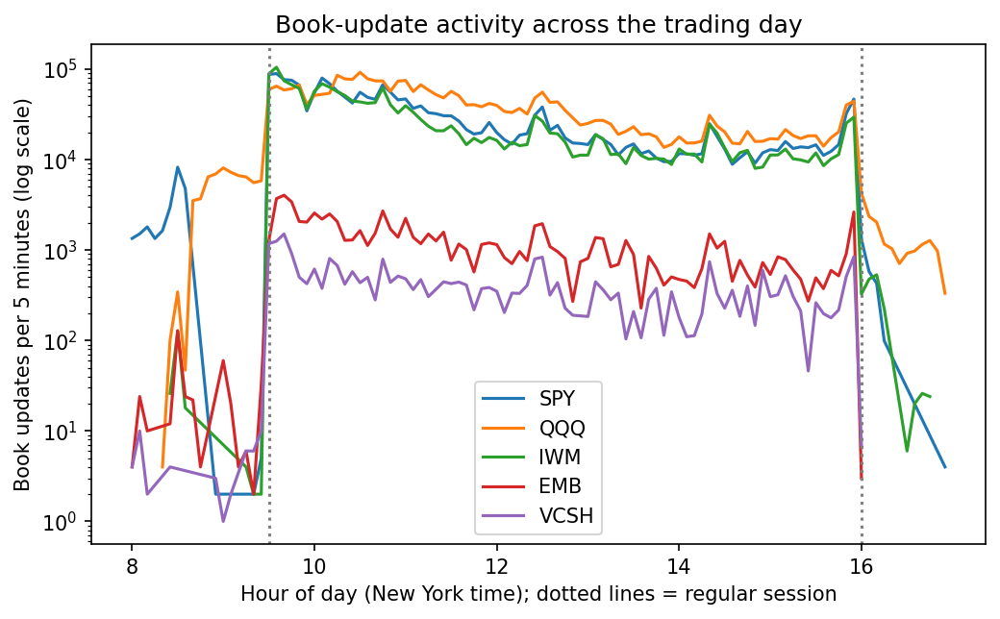
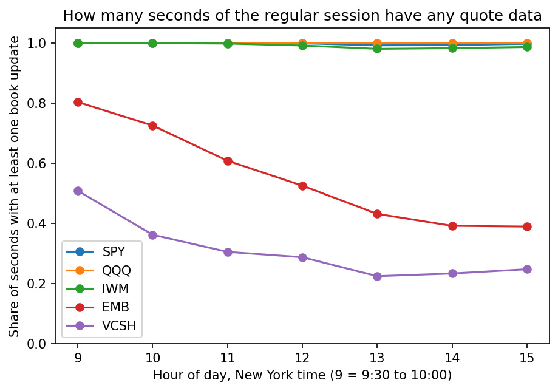
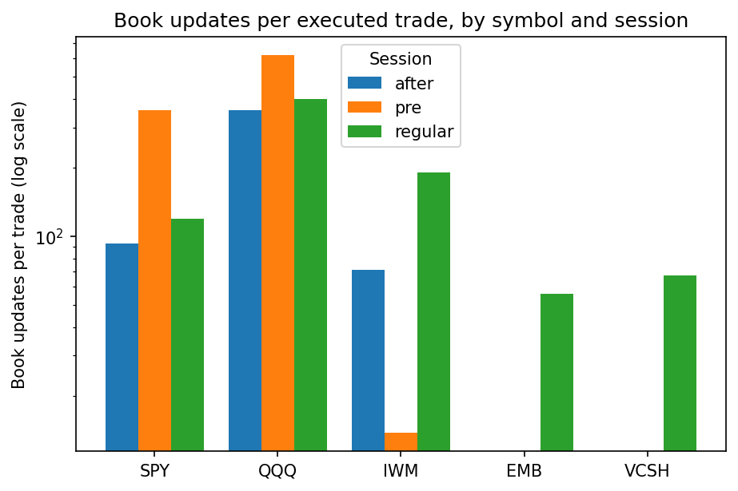
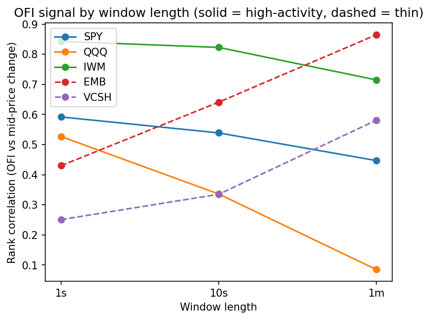
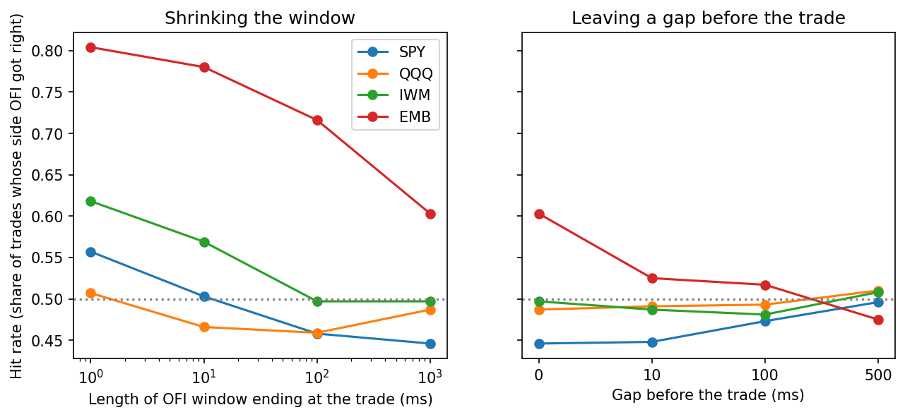

# From Raw Packets to Price Signals: A Scalable Pipeline for Order-Flow Imbalance Analysis on IEX Market Data

**EAS 587 Data Intensive Computing, Fall 2026. Phase 2 Report**

## 1. Title and Team Members

Anvesh Sadam, Varshitha Gangadi, Hanu Varma Pinamaraju (Team V-A-H).
Repository: https://github.com/find-me1/iex-order-flow-imbalance

## 2. Executive Summary

We turned an 11.6 GB IEX DEEP capture from one trading day (Sep 11, 2026) into two analysis-ready Parquet tables (7.45 million rebuilt order-book states and 39,096 trades for SPY, QQQ, IWM, EMB and VCSH) and used them to ask whether order-flow imbalance (OFI) lines up with price moves and whether it predicts them. OFI and the change in the mid-price were positively correlated in every window we tried: the Spearman correlation over one second is 0.59 for SPY, 0.53 for QQQ, 0.84 for IWM, 0.43 for EMB and 0.25 for VCSH. The correlation changed with window length differently across the ETFs: for SPY, QQQ and IWM the link weakens as windows grow from one second to one minute, while for EMB and VCSH it gets stronger. As a predictor of the next trade’s direction, though, OFI did not beat simply guessing the majority side for SPY, QQQ or IWM, and EMB’s apparent edge faded toward chance when we left a short gap before the trade. Overall, OFI was correlated with price changes in the same window, but we found no consistent evidence that it predicts the next trade’s direction. All of this comes from one trading day, and the next-trade tests for EMB and VCSH used only 464 and 115 scored trades, so those results are less reliable.

## 3. Connection to Phase 1

Our Phase 1 research question asked whether short-term order-book imbalance predicts the direction of the next executed trade on IEX, and whether this differs between high-volume ETFs and thinly traded symbols. It came with two supporting questions: how the quote-to-trade ratio varies by symbol and time of day (Q1), and at which horizon (1 s, 10 s, 1 min) any relationship is strongest and whether it decays (Q2). Phase 2 answers Q1 in Section 6.1, Q2 in Section 6.2, and gives a first test of the primary question in Section 6.3.

Three things changed from the plan. First, we measure imbalance as order-flow imbalance (OFI): the changes in prices and sizes at the best bid and ask, following Cont, Kukanov and Stoikov (2014), computed from successive book updates. The plan described the ratio of resting buy to sell volume instead. Second, the symbol set is five ETFs, with EMB and VCSH as the thin tier, while the original plan referred to thinly traded equities. Third, the logistic-regression model for next-trade direction moves to Phase 3; in its place we report a simple hit-rate test against a majority baseline. In the Phase 1 sample we saw about 157 quote updates per trade; over the full day the regular-session figure ranges from 56 (EMB) to 399 (QQQ) depending on the symbol (Section 6.1).

## 4. Data Cleaning and Processing

### 4.1 Profiling

We profiled the full set of Parquet parts with lazy Polars queries (`src/profile_data.py`), not a sample. The raw capture holds 403,398,808 messages. We keep two message types for five symbols: `price_level_update` (a quote update at one price level) and `trade_report`. That leaves 7,867,434 rows: 7,828,338 quote updates and 39,096 trades.

| Column      | Type                | Meaning                                                       |
| ----------- | ------------------- | ------------------------------------------------------------- |
| `timestamp` | timestamp (µs, UTC) | message time                                                  |
| `symbol`    | string              | one of 5 ETFs                                                 |
| `type`      | string              | `price_level_update` or `trade_report`                        |
| `side`      | string              | `B` (bid side) or `S` (ask side) for quotes; empty for trades |
| `price`     | float64             | price level or trade price                                    |
| `size`      | int64               | shares at the level (0 = level removed) or trade size         |
| `flags`     | int64               | event-processing and trade flags                              |
| `trade_id`  | int64               | trade identifier; empty for quotes                            |

Missingness is systematic, not random: `side` is empty on every trade report and `trade_id` on every quote update, because each field exists for only one message type, so we leave both as null. A quote size of 0 is not missing data; it means the price level was removed. Of the quote updates, 376,831 (4.8%) have `flags` of 0, which marks an update in the middle of an event, so they are not finished book states. For us a duplicate is a row identical to the previous row for the same symbol in every column except the symbol; we found six and removed them. Cardinality is small: 5 symbols, 2 message types and 2 sides over 7,867,434 rows. The numeric distributions (OFI per update, price change per window) are in Section 5.

### 4.2 Cleaning and transformation

**Missing values.** We kept them as nulls and imputed nothing, because a made-up price or size would be invented market data. When one side of the book is empty the best bid or ask is null, so `mid`, `spread` and `ofi` are null for that state. The first state of each symbol also has a null `ofi` and `dmid`, since there is no earlier state to compare with.

**Duplicates, types and time.** The six duplicate rows were dropped before the book was rebuilt, because a repeated update would add an extra identical state. Types are fixed at parse time (table above), so there were no mixed types to repair. Timestamps stay in UTC and are converted to America/New_York only to label the session: `pre` before 9:30, `regular` from 9:30 to 16:00 and `after` from 16:00.

**Outliers.** We kept extreme values and looked into the unusual cases instead of deleting them. An extreme OFI value could be a real burst of activity, a side effect of how we rebuild the book, or an odd quote, and we cannot tell which without looking. The one case we acted on is the closing minute: a single far-away quote at 15:59 ET moved SPY's window mid-price by $11.805 (Section 7), so the window analyses stop at 15:59 ET, while those rows stay in the tables.

**Labels, not deletions.** `session` and `usable_trade` are columns rather than filters that drop rows, so we can still count what each rule removes (for example, 26,312 of 39,096 trades are usable).

We rebuild the book for each symbol by replaying its updates in file order. A price level is set to the update's size (not added to it) and removed when the size is 0. We record a book state (best bid, best ask and their sizes) only after an update with `flags` of 1. This gives 7,451,501 book states: 7,828,338 quote updates, minus 376,831 mid-event updates, minus 6 duplicates.

We then created these derived columns:

| Column         | Definition                                                                                                                                                                                                                                                                                                                                                                              | Purpose                                                   |
| -------------- | --------------------------------------------------------------------------------------------------------------------------------------------------------------------------------------------------------------------------------------------------------------------------------------------------------------------------------------------------------------------------------------- | --------------------------------------------------------- |
| `ofi`          | Order-flow imbalance at the best level, from the changes in best bid and ask price and size since the previous state (Cont, Kukanov and Stoikov, 2014): `[bq·1(bp ≥ bp₀) − bq₀·1(bp ≤ bp₀)] − [aq·1(ap ≤ ap₀) − aq₀·1(ap ≥ ap₀)]`, where `bp` and `ap` are the best bid and ask prices, `bq` and `aq` their sizes, and `₀` marks the previous state. Null unless all eight inputs exist | Positive means net buying pressure at the top of the book |
| `mid`          | (best bid + best ask) / 2                                                                                                                                                                                                                                                                                                                                                               | Price reference                                           |
| `spread`       | best ask − best bid                                                                                                                                                                                                                                                                                                                                                                     | Spots abnormal quotes                                     |
| `dmid`         | Change in `mid` since the previous state of the same symbol                                                                                                                                                                                                                                                                                                                             | Per-update price move                                     |
| `session`      | `pre`, `regular` or `after`                                                                                                                                                                                                                                                                                                                                                             | Separates trading hours                                   |
| `usable_trade` | Trade in the regular session with the extended-hours and odd-lot flag bits clear (26,312 of 39,096 trades)                                                                                                                                                                                                                                                                              | Selects trades for the next-trade test                    |

For the window analyses (`src/analytics.py`) we group the regular session into windows and compute `ofi_sum` (the sum of `ofi` in the window), `mid_end` (the last `mid` in the window) and `dmid_w` (the window's `mid_end` minus the `mid_end` of the previous non-empty window). Empty windows are not emitted, so on thin ETFs `dmid_w` can span a gap of several seconds.

### 4.3 Scalable processing strategy and runtime

The full capture is too large to hold in memory. We measured traced Python memory use while parsing a 100,000-message sample, which came to about 453.5 bytes per message, and scaled that to 403 million messages, an estimate of roughly 183 GB. So we stream the file one message at a time and write only the rows we keep to Parquet parts of 100,000 rows. After this filtering and Parquet compression, the 79 parts take up 76 MB, about 150 times smaller than the original compressed capture. Polars then scans all the parts lazily as one table. The rebuilt book is 47 MB on disk, and it is rebuilt one symbol at a time so only one symbol's quotes are in memory.

The parse took 10.2 hours on a single thread (about 11,000 messages per second) and is the main bottleneck. After it, cleaning takes about 20 seconds and the analytics about 30 seconds. We did not use Spark in Phase 2 because the parsed five-symbol data fits in memory on one machine. Distributed processing may become useful for the multi-day, wider-symbol runs planned for Phase 3, but it will not automatically be faster. For the statistical analysis, sampling is limited to fitting the robust line in Section 5: we use 5,000 randomly selected windows (seed 42), and every other statistic uses all windows.

## 5. Exploratory Data Analysis

We followed Tukey's order: graphs before summaries, re-expression (log scales) where tails hide structure, robust summaries (medians, Theil–Sen line, rank correlation), and a look at residuals. Unless noted, the plots use SPY, the most active symbol, in the regular session before 15:59 ET, and every plot is drawn from the processed tables.

**Figure 1.** SPY order-flow imbalance per book update (2,219,046 updates, regular session before 15:59 ET), in 100 equal-width bins. Left: raw counts. Right: log-scaled counts.

On raw counts almost every update falls into a few bins at zero (21.75% are exactly zero and 98% lie within ±200 shares), so the left panel shows nothing else. The log scale reveals tails out to about ±3,100 shares and two unexpected side peaks, at about ±1,500 shares (3,910 updates) and a smaller one at ±1,080 shares (51 updates). The ±1,500 cluster builds late in the day: in the 1,450 to 1,550 band there are 17 updates in the 11:00 hour, 518 in the 14:00 hour and 4,014 in the 15:00 hour (final minute included). The ±1,080 cluster is mostly the closing minute (360 updates with it, 51 without; 309 of 360 fall in that minute). This pattern is consistent with one quote size being added and removed repeatedly, but we have not tested that.

**Figure 2.** SPY OFI summed over each 1-second window against the change in mid-price over the window (23,280 windows; hexagonal bins, colour is the window count on a log scale). Red: Theil–Sen line fitted to a seeded random sample of 5,000 windows. Axes are clipped to about ±3,700 shares and ±$0.25 (1.98% of windows fall outside).

Windows with more buying imbalance tend to see the mid-price rise: the robust slope is 2.09 cents per 1,000 shares (interval 2.00 to 2.19) and the Spearman correlation is 0.592. The cloud is densest on a thin band at zero (18.4% of SPY windows have no price change) and fans out as the imbalance grows, so the spread of price changes increases with |OFI|, which is heteroscedasticity. The line describes the typical response, but the scatter is wide: 1,000 shares of imbalance moves the median price by about 2 cents, while the middle 98% of residuals span about ±16 cents.

**Figure 3.** Residuals (actual minus fitted mid-price change) of the SPY fit in Figure 2, against OFI. Orange: median residual in each of 20 OFI bins; red: zero.

The median residual stays near zero across the middle of the OFI range, so the straight line fits well where most windows lie. At the two ends it bends away: about +1.8 cents near −2,100 shares and about −1.5 cents near +2,100 shares, meaning the line overshoots and the true response flattens for very large imbalances. The residual percentiles (1%: −0.164, 25%: −0.011, 50%: 0.000, 75%: +0.011, 99%: +0.161 dollars) show a tight centre with long tails in both directions, which is why we preferred a resistant fit to least squares.

**Figure 4.** Book updates per 5 minutes for each symbol across the day (New York time, log scale). Dotted lines: regular session (9:30 to 16:00).

Activity jumps at the 9:30 open, declines through midday, rises again into the close and falls sharply after 16:00. SPY shows an unexplained bump of pre-market activity around 8:30, and QQQ is the only symbol with sustained activity after the close. The thin ETFs, EMB and VCSH, run one to two orders of magnitude below SPY, QQQ and IWM throughout the session, so a given window holds far fewer book updates for them.

**Figure 5.** Share of regular-session seconds with at least one book update, by hour (New York time; hour 9 is 9:30 to 10:00 and hour 15 is 15:00 to 16:00).

This is the missingness pattern that matters most for the analysis, because it concerns empty time rather than empty cells. SPY, QQQ and IWM have a quote update in nearly every second (99.7%, about 100% and 99.1% of the regular session). EMB covers only 53.5% and VCSH 29.5%, and the share falls through the day (EMB from about 0.80 to 0.39, VCSH from about 0.51 to 0.25). Because empty windows are not emitted, the price change for a thin ETF can span several seconds, which we keep in mind when comparing window lengths in Section 6.2.

## 6. First Analytics Results

Each result below answers one of the Phase 1 questions. The result CSVs are written by `src/analytics.py` to `results/`.

### 6.1 Quote activity per trade (Phase 1 question Q1)

**Figure 6.** Book updates per executed trade, by symbol and session (log scale). EMB and VCSH have no pre-market or after-hours trades.

In the regular session every symbol shows far more book updates than trades: QQQ 398.8, IWM 190.5, SPY 119.1, VCSH 67.5 and EMB 55.9 updates per trade. So most quote activity never ends in a trade, which matters because OFI is built entirely from these updates. The ratio varies by session as well as by symbol: SPY's pre-market ratio (357.7) is about three times its regular-session ratio, QQQ's is highest before the open (620.4, against 398.8 in the regular session and 357.4 after hours), and IWM's is much lower outside the regular session (13.8 pre-market and 71.0 after hours, against 190.5). Outside the regular session these ratios rest on only 13 to 98 trades each, so they are noisy.

### 6.2 How the OFI-price link changes with window length (Phase 1 question Q2)

**Figure 7.** Spearman rank correlation between window OFI and window mid-price change at 1-second, 10-second and 1-minute windows. Solid: high-activity ETFs; dashed: thin ETFs.

| Symbol | Spearman 1 s | 10 s  | 1 min | Slope (¢ per 1,000 sh) 1 s | 10 s   | 1 min  | No-change share, 1 s |
| ------ | ------------ | ----- | ----- | -------------------------- | ------ | ------ | -------------------- |
| SPY    | 0.592        | 0.539 | 0.447 | 2.0896                     | 1.3253 | 0.8376 | 0.184                |
| QQQ    | 0.527        | 0.336 | 0.085 | 1.4925                     | 0.6355 | 0.0913 | 0.127                |
| IWM    | 0.843        | 0.823 | 0.715 | 0.3561                     | 0.3519 | 0.2884 | 0.361                |
| EMB    | 0.430        | 0.641 | 0.865 | 0                          | 0      | 0.1326 | 0.893                |
| VCSH   | 0.251        | 0.335 | 0.581 | 0                          | 0      | 0      | 0.967                |

Window counts: at one second SPY 23,280, QQQ 23,338, IWM 23,132, EMB 12,462 and VCSH 6,859; at ten seconds 2,333 for SPY, QQQ and IWM, 2,228 for EMB and 2,017 for VCSH; at one minute 388 for every symbol. QQQ's one-minute slope has an interval that reaches zero (0.0 to 0.1854).

For the three high-activity ETFs the correlation is strongest at one second and decays with longer windows, fastest for QQQ (0.527 to 0.085). IWM keeps the strongest link of the three at every window length, yet at one and ten seconds it has the smallest slope, so a tight association does not imply a large price impact. Slopes are in raw cents per 1,000 shares, so they are not standardized for comparison across ETFs. The thin ETFs behave the opposite way: their correlation rises with window length (EMB 0.430 to 0.865, VCSH 0.251 to 0.581). A likely reason is that their books are quiet: at one second 89.3% of EMB windows and 96.7% of VCSH windows show no price change, which forces the median-based slope to zero, and the share of flat windows drops as windows lengthen (EMB 48.5% at one minute). A Theil–Sen slope is zero once more than about 71% of windows show no change, which matches exactly which cells above are zero. Our data cannot say why QQQ's signal fades so fast, why IWM's is stronger than SPY's, or how much depth, tick size or activity on other venues contributes. These are same-window associations, not predictions, and the one-minute counts are small.

### 6.3 Does OFI predict the next trade? (primary research question)

IEX does not say which side started a trade, so we label each usable trade: a buy if it prints above the quote midpoint just before it, a sell if below, and exact ties are dropped. As a label check, SPY's mid-price rises 1.8 cents on average over the next second after a labelled buy and falls 2.3 cents after a labelled sell, in the direction we expect. For IWM and VCSH the average change is positive after both buys and sells, though larger after buys, so the check is only partly consistent. The feature is OFI summed over the second before the trade, using only book states strictly earlier than the trade. The hit rate is the share of trades where the sign of that OFI matches the trade side; the baseline is always guessing the majority side.

| Symbol | Hit rate | Majority baseline | Trades scored |
| ------ | -------- | ----------------- | ------------- |
| SPY    | 0.446    | 0.526             | 10,065        |
| QQQ    | 0.487    | 0.596             | 4,080         |
| IWM    | 0.497    | 0.556             | 6,323         |
| EMB    | 0.603    | 0.530             | 464           |
| VCSH   | 0.565    | 0.595             | 115           |

**Figure 8.** Share of trades whose side matched the sign of OFI. Left: the OFI window is shortened to end at the trade (1 ms to 1 s). Right: a 1-second OFI window ending 0 to 500 ms before the trade. Dotted line: 0.5. VCSH (115 trades) is not plotted.

For SPY, QQQ and IWM the hit rate is below the baseline, so OFI over the prior second does not help guess the next trade's side; SPY's 0.446 is even below one half, which we cannot explain. EMB's 0.603 beats its baseline of 0.530, but only on 464 trades. Shortening the OFI window to 1 ms gives a higher hit rate than the full second for every symbol (EMB 0.603 to 0.804, IWM 0.497 to 0.618, SPY 0.446 to 0.557, QQQ 0.487 to 0.507), yet leaving a gap before the trade pushes it back toward 0.5 (EMB 0.525 with a 10 ms gap, 0.475 at 500 ms; SPY 0.448 to 0.496). An effect that exists only in the last few milliseconds is what we would expect if the trade's own book update leaks into the feature, so we do not count the short-window numbers as prediction. This is a hypothesis we have not proven. Dropping the closing minute from the trades changes little (SPY 0.439 against a baseline of 0.533, EMB 0.640 against 0.559 on 411 trades).

Two limits apply. First, the baseline uses all classified trades, but the hit rate uses only trades whose prior-second OFI is not zero; for EMB and VCSH about 35% and 48% of classified trades have zero OFI, so the two numbers are not computed on the same trades, and EMB's comparison is the one most affected. Second, the data is one day, and the thin-ETF samples are small. These results set up Phase 3: a logistic-regression model on more days and symbols, a repeat of the gap test on more data, and a check of whether the slope falls as market depth rises, as Cont, Kukanov and Stoikov report.

## 7. Dead Ends

**The first plot was dominated by one quote.** Our first look at OFI against price change was stretched by a single window: in the second ending at 15:59:59 ET, a quote far from the market widened SPY's spread from $0.27 to $23.64 across 767 book states, and the window's mid-price jumped $11.805 (the next largest move is $1.115, at 09:40:36). The summary statistic hid this; looking at the extremes found it. Dropping 15:59 ET onward barely moved the results (Spearman 0.5920 to 0.5919, 23,340 to 23,280 windows), but the plots became readable. We learned to inspect extremes before trusting a correlation.

**One-second windows for the thin ETFs.** We first fitted the robust line to one-second windows for every symbol. For EMB and VCSH, 89.3% and 96.7% of windows had no price change, so the median of the pairwise slopes was exactly zero and told us nothing. We switched to rank correlation and added 10-second and 1-minute windows. We learned that the right window length depends on how active a symbol is.

**OFI as a next-trade predictor.** The hit rates in Section 6.3 sat below the baseline for SPY, QQQ and IWM, and EMB's apparent edge grew as we shortened the window but vanished when we added a gap. We learned to test for leakage before trusting a hit rate, so the classifier model moves to Phase 3.

## 8. Design Decisions

| Decision                                           | Alternatives considered                | Rationale                                                                                                                                                            |
| -------------------------------------------------- | -------------------------------------- | -------------------------------------------------------------------------------------------------------------------------------------------------------------------- |
| Theil–Sen robust line                              | Ordinary least squares                 | Heavy-tailed windows (Figure 3) would pull a least-squares fit; the median of pairwise slopes resists them. Cost: it is zero when over about 71% of windows are flat |
| Label sessions and trades instead of deleting rows | Delete extended-hours and odd-lot rows | Every filter stays reversible and its effect countable (26,312 of 39,096 trades usable)                                                                              |
| Drop 15:59 ET onward from window analyses only     | Keep it; or drop it from the data      | One window moved $11.805 against $1.115 for the next largest. Keeping the rows in the data preserves the evidence of the artifact                                    |
| Retain extreme OFI values                          | Cap or remove outliers                 | Large values are real book events and the ±1,500 clusters are findings, not errors                                                                                   |
| Polars and Parquet on one machine                  | Spark from the start; SQLite           | The parsed data is 76 MB and fits in memory; the 10-hour parse, not the analysis, is the cost. Spark waits for multi-day scale in Phase 3                            |
| Rank correlation for the thin ETFs                 | Slope only                             | The slope is zero when most windows show no change; ranks still carry information                                                                                    |
| Windows of 1 s, 10 s and 1 min                     | A single window                        | Phase 1 question Q2 asks how the relationship changes with horizon                                                                                                   |
| One day, five symbols                              | More days or symbols                   | The single-threaded parse of one day alone took 10.2 hours, so more data waits for the distributed pipeline in Phase 3; one day limits every conclusion              |
| Hit rate against a majority baseline               | A logistic-regression model now        | The simple test shows the leakage problem before a model would hide it; the model is Phase 3                                                                         |

## 9. Reproducibility Statement

The Phase 2 processing runs from one entry point, `python src/pipeline.py` (parse, profile, clean), after `pip install -r requirements.txt`; `python src/analytics.py` then writes the result tables, and `notebooks/phase2_analysis.ipynb` reads only `data/processed/`. The one random operation, the 5,000-window sample for the robust fit, uses seed 42. A fresh clone includes `data/processed/`, so the analytics and the notebook run without the raw file; rebuilding from the raw capture requires downloading it (see the README) and takes about 10 hours.

**Dry run.** On October 23, 2026, Varshitha Gangadi ran the project on a Windows laptop in a new virtual environment. After `pip install -r requirements.txt`, `python src/analytics.py` ran from `data/processed/` and wrote all result tables to `results/`; its numbers matched ours (for example SPY one-second Spearman 0.592 and slope 2.0896 cents per 1,000 shares, and EMB next-trade hit rate 0.603 against a 0.530 baseline), and it printed only Polars sortedness warnings. `python src/pipeline.py` in the same environment stopped at its first stage with a clear message that the 11.6 GB raw capture and the parsed parts are not in the repository, as designed, so the parse and clean stages were not re-run in a fresh environment.

## 10. References

1. Tukey, J. W. (1977). _Exploratory Data Analysis_. Addison-Wesley.
2. Cont, R., Kukanov, A., and Stoikov, S. (2014). The Price Impact of Order Book Events. _Journal of Financial Econometrics_, 12(1), 47–88.
3. IEX Group. _IEX Historical Data and DEEP/TOPS Specification_. iextrading.com.
